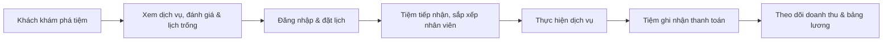

# SHN — Nền tảng đặt lịch & quản lý dịch vụ làm đẹp

**Một nơi để khách hàng khám phá tiệm làm đẹp, một hệ thống để chủ tiệm vận hành công việc hằng ngày.**

SHN kết nối khách hàng với các tiệm nail, salon tóc, spa và những dịch vụ làm đẹp khác. Khách có thể tìm tiệm, xem dịch vụ và lịch trống rồi đặt hẹn trên web. Ở phía cửa hàng, SHN tập trung lịch hẹn, dịch vụ, nhân sự, chấm công, giao dịch và bảng lương vào một không gian quản lý. Trợ lý AI giúp nhân viên và chủ tiệm tra cứu dữ liệu vận hành bằng câu hỏi tự nhiên.

> Đây là repository **backend API**. Giao diện React nằm tại [DBHOME_APP](https://github.com/binhvuong1772003/DBHOME_APP).

## SHN dành cho ai?

| Người dùng             | Họ làm được gì?                                                                                                                           |
| ---------------------- | ----------------------------------------------------------------------------------------------------------------------------------------- |
| **Khách hàng**         | Tìm tiệm theo tên, địa điểm hoặc loại hình; xem dịch vụ, đánh giá và lịch trống; đăng nhập và đặt lịch.                                   |
| **Chủ tiệm / quản lý** | Tạo hồ sơ cửa hàng, đăng dịch vụ và hình ảnh, sắp lịch nhân viên, theo dõi cuộc hẹn, ghi nhận thanh toán, xem doanh thu và quản lý lương. |
| **Nhân viên**          | Xem lịch làm việc, check-in/check-out bằng QR, gửi yêu cầu nghỉ phép, theo dõi chấm công và bảng lương của mình.                          |

## Luồng trải nghiệm



- **Từ tìm kiếm đến đặt lịch:** marketplace hiển thị shop đang hoạt động; khách chọn dịch vụ, nhân viên (nếu có) và giờ còn trống. Khách cần đăng nhập để gửi yêu cầu đặt lịch.
- **Từ đặt lịch đến vận hành:** chủ tiệm quản lý trạng thái cuộc hẹn, ca làm, nhân viên và khách hàng. Nhân viên có thể chấm công bằng QR và gửi yêu cầu nghỉ.
- **Từ giao dịch đến báo cáo:** quản lý ghi nhận khoản đã thu cho lịch hẹn, theo dõi thanh toán một phần/đủ, xem báo cáo tài chính và tạo bảng lương.

> **Phạm vi thanh toán hiện tại:** backend lưu phương thức, số tiền đã thu, trạng thái và cho phép quản lý xác nhận giao dịch. Chưa tích hợp cổng thanh toán online tự động (ví dụ MoMo/VNPay); tên các phương thức trong dữ liệu không có nghĩa là đã kết nối gateway.

## Trợ lý AI cho cửa hàng

Thay vì tìm qua nhiều màn hình, thành viên cửa hàng có thể hỏi trực tiếp:

> “Cho tôi xem chấm công tháng này của nhân viên A.”
>
> “Doanh thu tháng này thế nào?”
>
> “Hôm nay và ngày mai có những lịch hẹn nào?”

Trợ lý dùng **OpenAI Agents SDK + OpenRouter** để xử lý hội thoại và kết nối **MCP server** tới dữ liệu của đúng cửa hàng. Các công cụ hiện có hỗ trợ tra cứu lịch hẹn, lịch làm, chấm công, doanh thu, lương, khách hàng và dịch vụ; một số thao tác như tạo/sửa/hủy lịch hẹn hoặc xin nghỉ phép được giới hạn theo quyền của người dùng. Lịch sử hội thoại được lưu theo người dùng và cửa hàng. AI cần được cấu hình và chạy cùng MCP server; câu trả lời không thay thế bước kiểm tra nghiệp vụ.

## Công nghệ

**Giao diện** ([repo riêng](https://github.com/binhvuong1772003/DBHOME_APP))


**API & dữ liệu**


**AI & vận hành**


Backend còn dùng **Zod** (validation), **JWT/Google OAuth** (xác thực), **BullMQ** (hàng đợi email/lời mời), **Socket.IO** (cập nhật thời gian thực), **Cloudinary** (ảnh), **MCP** (công cụ cho AI) và **Sentry** (theo dõi lỗi).

## Kiến trúc tổng quan

```text
React app ──HTTP/Socket.IO──> Express API ──Prisma──> MongoDB
                                  │
                                  ├── Redis + BullMQ ──> email/invite workers
                                  ├── Cloudinary ──────> ảnh cửa hàng/dịch vụ
                                  └── AI agent ────────> OpenRouter
                                         │
                                         └── MCP server ──> công cụ theo quyền shop
```

Backend tổ chức theo `src/route` → `src/controller` → `src/service`; `src/validation` kiểm tra đầu vào, `src/middleware` xử lý xác thực/phân quyền, `prisma/schema.prisma` định nghĩa dữ liệu. Metrics/Sentry nằm trong `src/observability`, chatbot và MCP trong `src/ai` và `src/mcp`.

## Chạy backend trên máy

**Yêu cầu:** Node.js 20+, npm, Redis 6+ và MongoDB replica set/Atlas (Prisma cần replica set cho transaction). Không cần chạy frontend để thử API.

```bash
npm install
cp .env.production.example .env
```

Đổi `NODE_ENV=development` trong `.env`, sau đó điền ít nhất các biến dưới đây bằng giá trị **của riêng bạn**:

```env
PORT=3000
DATABASE_URL="mongodb+srv://<user>:<password>@<cluster>/<database>"
REDIS_HOST=127.0.0.1
REDIS_PORT=6379
JWT_ACCESS_SECRET=<random-secret>
JWT_REFRESH_SECRET=<another-random-secret>
QR_SECRET=<another-random-secret>
SESSION_SECRET=<another-random-secret>
FRONTEND_URL=http://localhost:5173
OPENROUTER_API_KEY=<your-openrouter-key>
```

Giữ `.env` ngoài Git. API khởi tạo OpenRouter client khi chạy, nên cần `OPENROUTER_API_KEY` ngay cả khi chưa dùng chat; để AI hoạt động, đặt thêm `OPENROUTER_MODEL`, `MCP_INTERNAL_SECRET` và `MCP_SERVER_URL=http://localhost:8080/mcp` (ghi đè URL Docker trong file mẫu). Google OAuth, gửi email thật và upload ảnh cần thêm biến tương ứng trong `src/config/google.config.ts`, `src/utils/mailer.ts` và `src/config/cloudinary.ts`.

```bash
npm run prisma:generate
npm run dev
```

Chỉ chạy `npm run prisma:push` khi thiết lập **database phát triển mới** và đã kiểm tra đúng `DATABASE_URL`; lệnh này đồng bộ schema/index, **không** sao chép dữ liệu từ database khác. API mặc định chạy tại `http://localhost:3000`.

Nếu dùng AI hoặc các công việc chạy nền, mở thêm terminal:

```bash
npm run dev:mcp
npm run dev:worker
npm run dev:staff-invite-worker
```

Có thể dùng `docker compose up --build` để chạy backend, MCP server, Redis, workers và monitoring cùng nhau; MongoDB vẫn cần được cấu hình qua `DATABASE_URL`. Frontend chạy riêng theo hướng dẫn ở [DBHOME_APP](https://github.com/binhvuong1772003/DBHOME_APP).

## API chính

| Đường dẫn                               | Chức năng                                                       |
| --------------------------------------- | --------------------------------------------------------------- |
| `/auth`                                 | Đăng ký/đăng nhập, xác minh email, Google OAuth, refresh token. |
| `/api/marketplace/shops`                | Tìm shop công khai, xem chi tiết, đánh giá và lịch trống.       |
| `/api/shops/:shopSlug/appointments`     | Đặt lịch, quản lý trạng thái và thanh toán theo lịch hẹn.       |
| `/api/shops/:shopSlug/services`         | Dịch vụ, danh mục, tùy chọn, add-on và gói dịch vụ.             |
| `/api/shops/:shopSlug/staff`            | Nhân viên, lịch làm, nghỉ phép và cấu hình lương.               |
| `/api/shops/:shopSlug/attendance`       | Check-in/out QR, chấm công và lịch sử.                          |
| `/api/shops/:shopSlug/payments`         | Danh sách và chi tiết giao dịch.                                |
| `/api/shops/:shopSlug/payrolls`         | Bảng lương nhân viên.                                           |
| `/api/shops/:shopSlug/financial-report` | Báo cáo tài chính.                                              |
| `/api/ai/shops/:shopSlug/chat`          | Trò chuyện với trợ lý AI theo quyền của thành viên shop.        |
| `/metrics`                              | Metrics cho Prometheus.                                         |

Các API quản lý shop yêu cầu access token (`Authorization: Bearer <token>`) và kiểm tra vai trò thành viên. API marketplace cho phép xem thông tin công khai mà không cần đăng nhập; đặt lịch yêu cầu tài khoản.

## Kiểm tra & build

```bash
npx prisma validate
npx tsc --noEmit
npm run build
npm start
```

`npm start` chạy bản đã build trong `dist/`. Repo này không có lệnh test tự động trong `package.json`.
